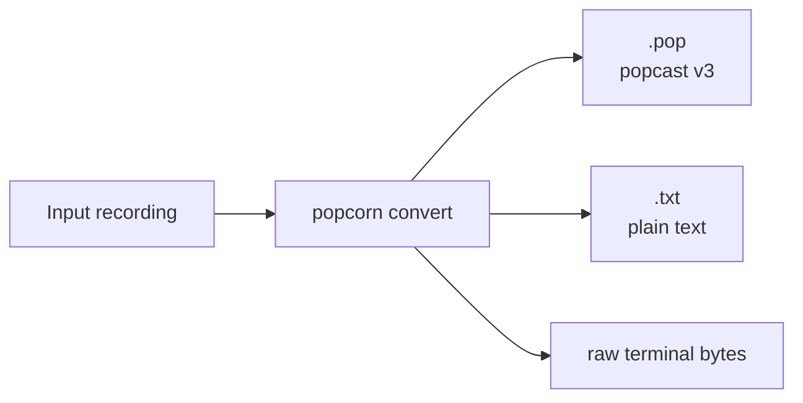
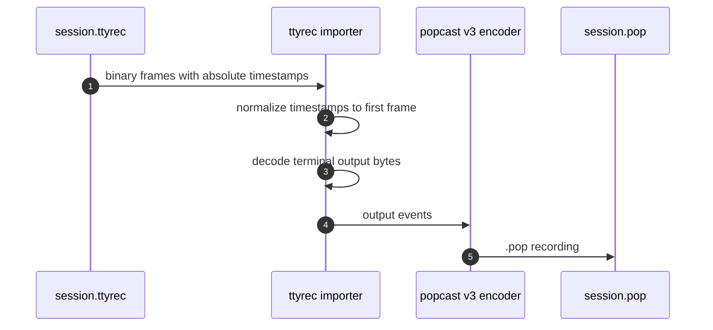

# Converting recordings

Use `popcorn convert` to turn recordings into another Popcorn recording, a text
transcript, or raw terminal output.

## Common conversions

Convert a `.pop` recording to the current popcast format:

```sh
popcorn convert old.pop current.pop
```

Write a plain text transcript:

```sh
popcorn convert demo.pop demo.txt
```

Write raw terminal output:

```sh
popcorn convert --output-format raw demo.pop demo.raw
```

The output format defaults to popcast v3. A `.txt` output filename selects text
output automatically unless `--output-format` is set explicitly.



## Import ttyrec files

Popcorn can import ttyrec binary recordings with `--input-format ttyrec`.

```sh
popcorn convert --input-format ttyrec session.ttyrec session.pop
```

You can also convert ttyrec output directly to text:

```sh
popcorn convert --input-format ttyrec --output-format txt session.ttyrec session.txt
```

The ttyrec importer preserves terminal output timing relative to the first frame
and decodes UTF-8 across frame boundaries. ttyrec does not carry Popcorn
metadata such as title, terminal theme, markers, or recorded terminal size, so
the generated `.pop` file uses default metadata.



## Standard input and standard output

Use `-` for standard input or standard output.

```sh
cat demo.pop | popcorn convert - demo.txt
popcorn convert demo.pop - > demo.pop
```

When reading ttyrec data from standard input, still pass the input format:

```sh
cat session.ttyrec | popcorn convert --input-format ttyrec - session.pop
```

## Compression

Popcast input files may be compressed with zstd. Add `.zst` to the output path
to write zstd-compressed output:

```sh
popcorn convert demo.pop demo.pop.zst
popcorn convert demo.pop.zst demo.pop
```

Compression applies to the output writer. It does not change the selected
recording format.

## Overwriting output

`convert` refuses to overwrite existing files by default:

```sh
popcorn convert demo.pop demo.txt
```

If `demo.txt` already exists, pass `--overwrite`:

```sh
popcorn convert --overwrite demo.pop demo.txt
```

## Choosing formats explicitly

Use `--input-format` for the source file format and `--output-format` for the
destination format.

| Option | Values | Default |
| --- | --- | --- |
| `--input-format` | `popcast`, `ttyrec` | `popcast` |
| `--output-format` | `popcast-v3`, `popcast-v2`, `raw`, `txt` | inferred from output path, otherwise `popcast-v3` |

Run `popcorn convert --help` for the complete command reference.
