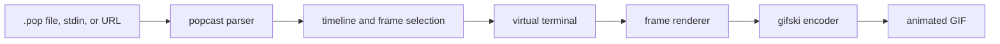
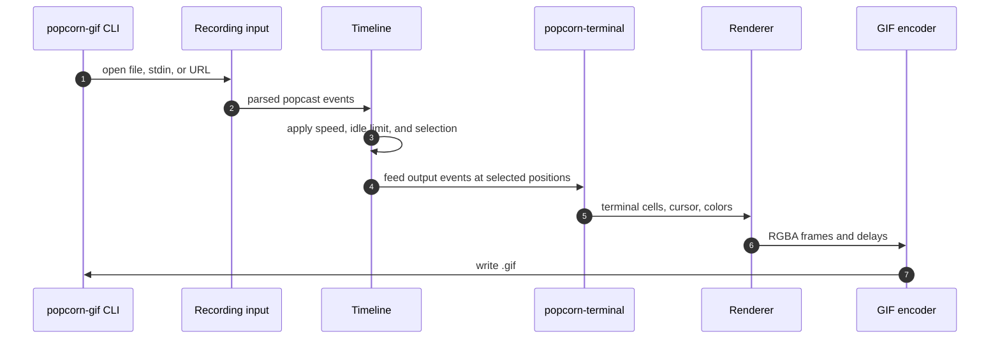

# popcorn-gif

[](https://github.com/dotbrains/popcorn/actions/workflows/ci.yml)
[](https://github.com/dotbrains/popcorn/actions/workflows/release.yml)
[](https://github.com/dotbrains/popcorn/releases/latest)
[](Cargo.toml)
[](Cargo.toml)
[](LICENSE)

`popcorn-gif` renders animated GIF files from Popcorn terminal session
recordings.

Use it when a destination cannot embed the browser player, such as issue
comments, chat systems, slide decks, static documentation, or release notes.

## What It Does

`popcorn-gif` reads a `.pop` recording from a local file, standard input, or an
HTTP(S) URL. It parses the popcast event stream, replays terminal output through
Popcorn's terminal model, renders terminal frames with the selected renderer,
and encodes the result as an optimized GIF.



## Features

- Popcast v1, v2, and v3 input.
- Local files, standard input, and HTTP(S) URLs.
- Optimized GIF output with accurate frame timing through `gifski`.
- Built-in themes including `popcorn`, `dracula`, `monokai`, `github-dark`,
  `github-light`, `kanagawa`, `nord`, `solarized-dark`, `solarized-light`, and
  `gruvbox-dark`.
- Custom themes with explicit foreground, background, and palette colors.
- Embedded recording themes when present.
- Text and emoji font family controls.
- Bundled symbol and emoji fallback fonts.
- Extra font search directories through `--font-dir`.
- `swash` renderer by default, with `resvg` as an alternate renderer.
- Playback speed and idle-time controls.
- Frame selection by time range, marker, percentage, event index, or discrete
  frame position.
- Looping, final-frame duration, FPS cap, and terminal geometry overrides.

## Rendering Pipeline



The renderer receives terminal state, not raw text. That keeps cursor movement,
wrapping, color, alternate screen behavior, and resizing consistent with other
Popcorn components.

## Install

Install from the repository with Cargo:

```sh
cargo install --locked --git https://github.com/dotbrains/popcorn --package popcorn-gif
```

Make sure Cargo's bin directory is on your `PATH`:

```sh
export PATH="$HOME/.cargo/bin:$PATH"
```

Confirm the binary is available:

```sh
popcorn-gif --help
```

## Build From Source

From the repository root:

```sh
cargo build -p popcorn-gif --release --locked
```

The optimized binary is written to:

```text
target/release/popcorn-gif
```

## Usage

Render a recording to a GIF:

```sh
popcorn-gif demo.pop demo.gif
```

Read a recording from standard input:

```sh
cat demo.pop | popcorn-gif - demo.gif
```

Render a recording from a URL:

```sh
popcorn-gif https://popcorn.example.com/a/569727 demo.gif
```

Customize the result:

```sh
popcorn-gif \
  --theme monokai \
  --text-font-family "JetBrainsMono Nerd Font Mono" \
  --emoji-font-family "Apple Color Emoji,Noto Color Emoji" \
  --font-size 20 \
  --line-height 1.4 \
  --speed 1.5 \
  demo.pop \
  demo.gif
```

Render a clip:

```sh
popcorn-gif --select 5..30 demo.pop clip.gif
popcorn-gif --select marker:build..marker:test demo.pop build.gif
```

Render at a fixed terminal size:

```sh
popcorn-gif --cols 100 --rows 30 demo.pop demo.gif
```

## Source Map

| Path | Responsibility |
| --- | --- |
| `src/main.rs` | CLI options, argument validation, and top-level command execution. |
| `src/lib.rs` | Public crate exports. |
| `src/popcast/` | Popcast v1, v2, and v3 input parsing. |
| `src/timeline.rs` | Event timeline transforms such as speed and idle limiting. |
| `src/selection.rs` | Frame selection resolution. |
| `src/frames.rs` | Selected terminal state generation. |
| `src/terminal.rs` | Bridge from popcast events into `popcorn-terminal`. |
| `src/renderer.rs` | Renderer abstraction and shared rendering behavior. |
| `src/renderer/swash.rs` | Default glyph renderer. |
| `src/renderer/resvg.rs` | SVG/text based renderer path. |
| `src/fonts.rs` | Font discovery, fallback, and bundled font handling. |
| `src/theme.rs` | Built-in and custom terminal themes. |
| `src/output.rs` | GIF frame output and encoder integration. |
| `fonts/` | Bundled fallback fonts and their licenses. |

## Docker

Build a local container image:

```sh
docker build -t popcorn-gif crates/agg
```

Run it with the current directory mounted at `/data`:

```sh
docker run --rm -u "$(id -u):$(id -g)" -v "$PWD:/data" popcorn-gif demo.pop demo.gif
```

With rootless Podman:

```sh
podman run --rm -v "$PWD:/data" popcorn-gif demo.pop demo.gif
```

## Test

Run crate tests:

```sh
cargo test -p popcorn-gif --locked
```

Run full Rust workspace quality checks before renderer, parser, or font
changes:

```sh
cargo fmt --all --check
cargo clippy --workspace --all-targets --locked -- -D warnings
cargo test --workspace --locked
```

## Contributor Notes

- Renderer changes should include pixel-level or behavior-specific tests where
  practical.
- Font changes should preserve fallback behavior for symbols, emoji, CJK text,
  and common monospace families.
- Timeline and selection changes should keep deterministic ordering. GIF output
  is sensitive to frame timestamps and deduplication.
- Keep generated GIF examples out of this crate unless they are intentionally
  part of documentation or fixtures.
- Prefer `.pop` examples in docs and tests.

## Documentation

Full user documentation lives in the Popcorn docs:

- [popcorn-gif overview](../../apps/docs/docs/manual/popcorn-gif/index.md)
- [installation](../../apps/docs/docs/manual/popcorn-gif/installation.md)
- [usage](../../apps/docs/docs/manual/popcorn-gif/usage.md)
- [popcast format](../../apps/docs/docs/manual/popcast/v3.md)

## License

`popcorn-gif` is licensed under the PolyForm Shield License 1.0.0. See
[LICENSE](./LICENSE) for details.
