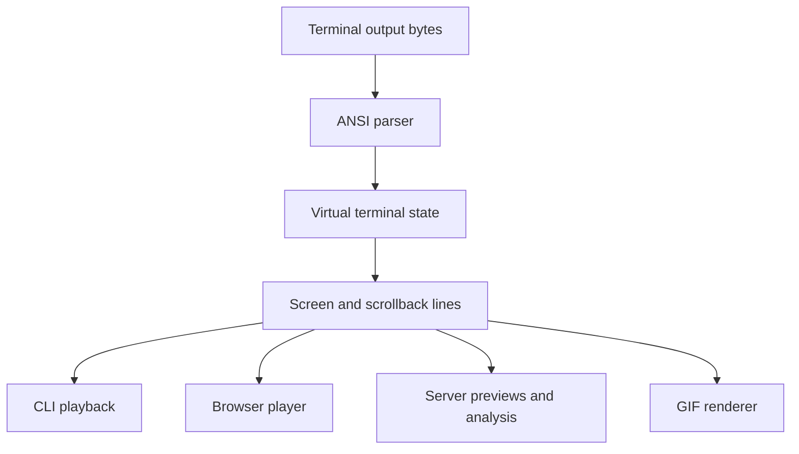
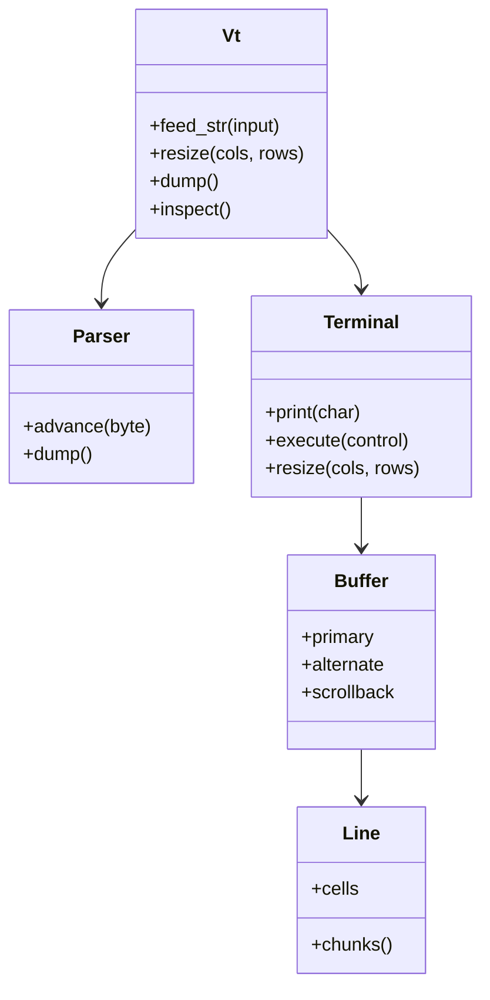

# popcorn-terminal

[](https://github.com/dotbrains/popcorn/actions/workflows/ci.yml)
[](https://github.com/dotbrains/popcorn/actions/workflows/release.yml)
[](https://github.com/dotbrains/popcorn/releases/latest)
[](Cargo.toml)
[](Cargo.toml)
[](LICENSE)

`popcorn-terminal` is Popcorn's virtual terminal engine. It parses terminal
control sequences, maintains screen state, and exposes a stable model that the
CLI, browser player, server, and GIF renderer can all use.

It is intentionally not a full terminal emulator application. It does not own
keyboard input handling, process management, font rendering, GPU rendering, or
window management. It owns the parser and the virtual terminal state needed to
turn terminal output bytes into inspectable screen contents.

## Where It Fits



Popcorn components should use this crate when they need terminal semantics:
cursor movement, color, alternate screen behavior, resizing, wrapping, character
sets, tabs, SGR attributes, and line extraction.

## Core Model



The public `Vt` type is the main integration point. It accepts text, advances
the parser, applies terminal actions, and returns changed lines for rendering
or inspection.

## Scope

In scope:

- ANSI-compatible parser state machine.
- Primary and alternate screen buffers.
- Cursor position, saved cursor, tabs, wrapping, and resize behavior.
- SGR color and style attributes.
- Charset translation for supported character sets.
- Text extraction with and without scrollback.
- Dump/restore support used by tests and callers that need snapshots.

Out of scope:

- PTY creation and child process management.
- Keyboard protocol handling.
- Font selection and glyph shaping.
- Pixel rendering.
- Network streaming or recording file formats.

## Source Map

| Path | Responsibility |
| --- | --- |
| `src/lib.rs` | Public exports and crate-level API surface. |
| `src/vt.rs` | High-level virtual terminal facade. |
| `src/parser.rs` | ANSI parser state machine and parser dump logic. |
| `src/terminal.rs` | Terminal action application and screen state behavior. |
| `src/terminal/` | Cursor and dirty-line helpers. |
| `src/buffer.rs` | Terminal buffer, scrollback, and resize behavior. |
| `src/line.rs` | Line and styled-cell chunk handling. |
| `src/cell.rs` | Cell data model. |
| `src/pen.rs` | SGR style state. |
| `src/color.rs` | Color model. |
| `src/charset.rs` | Character set translation. |
| `src/tabs.rs` | Tab stop state. |
| `src/util.rs` | Text extraction helpers. |
| `benches/` | Parser, VT, and charset benchmarks. |
| `tests/` | Integration tests. |

## Build

From the repository root:

```sh
cargo build -p popcorn-terminal --locked
```

For an optimized build:

```sh
cargo build -p popcorn-terminal --release --locked
```

## Test

Run the crate tests:

```sh
cargo test -p popcorn-terminal --locked
```

Run a focused parser or terminal test:

```sh
cargo test -p popcorn-terminal parser::tests::parse_csi_seq --locked
cargo test -p popcorn-terminal terminal::tests::resize --locked
```

Run benchmarks:

```sh
cargo bench -p popcorn-terminal
```

Run full Rust workspace quality checks before changing parser or terminal
behavior:

```sh
cargo fmt --all --check
cargo clippy --workspace --all-targets --locked -- -D warnings
cargo test --workspace --locked
```

## Contributor Notes

- Prefer behavior fixtures and focused regression tests for parser changes.
- Keep byte parsing separate from terminal action semantics.
- Be careful with resize behavior; it affects CLI playback, browser playback,
  server previews, and GIF rendering.
- Preserve dump/restore compatibility unless the caller-visible model changes
  intentionally.
- When a rendering issue appears in another component, first decide whether the
  bug is terminal state, text extraction, or renderer-specific pixels.

## License

`popcorn-terminal` is licensed under the PolyForm Shield License 1.0.0. See
[LICENSE](./LICENSE) for details.
