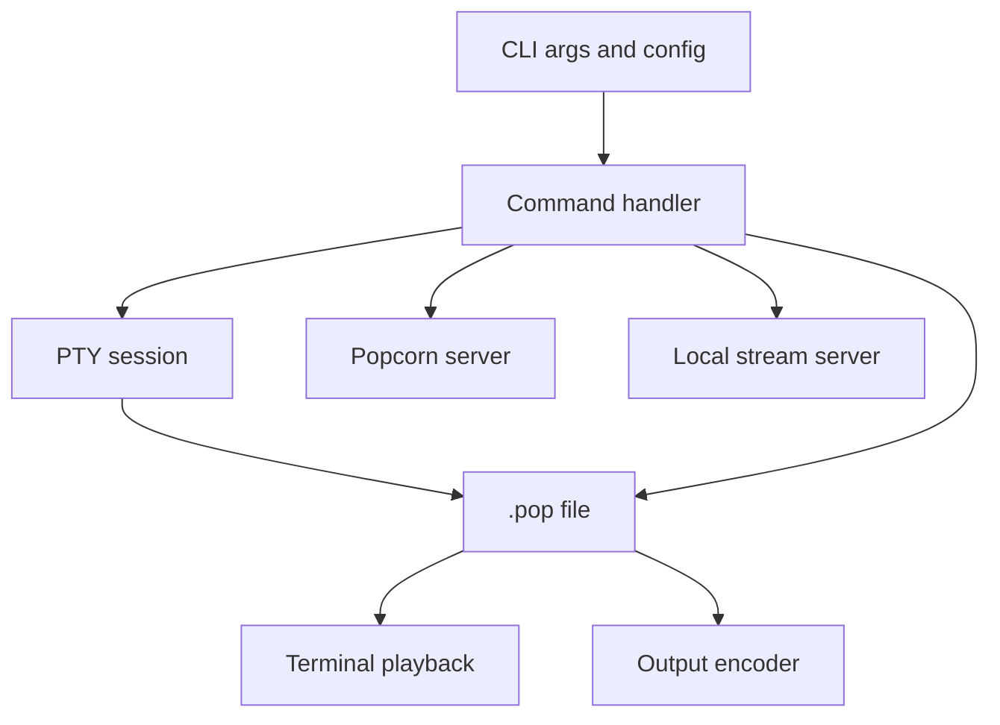
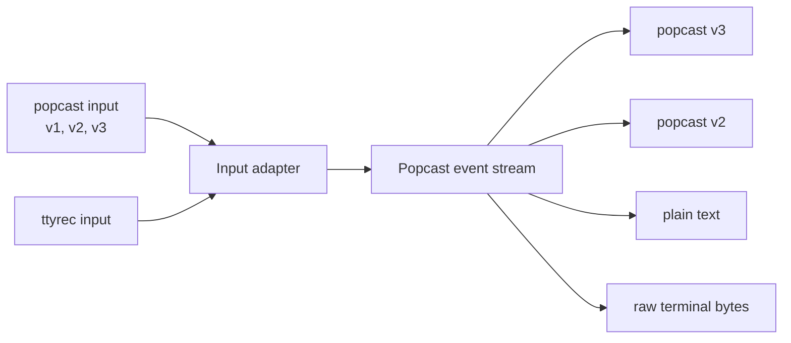

# popcorn CLI

[](https://github.com/dotbrains/popcorn/actions/workflows/ci.yml)
[](https://github.com/dotbrains/popcorn/actions/workflows/release.yml)
[](https://github.com/dotbrains/popcorn/releases/latest)
[](Cargo.toml)
[](Cargo.toml)
[](LICENSE)

`popcorn` is the command-line application for recording, replaying, converting,
concatenating, streaming, and uploading Popcorn terminal sessions.

The CLI writes `.pop` recordings in the popcast format, can replay those
recordings directly in a terminal, can run a local live stream server, and can
talk to a self-hosted Popcorn server for upload and remote streaming workflows.
Popcast files can be read from or written to zstd-compressed `.zst` files.

## What This Crate Owns

This crate owns user-facing terminal workflows:

- `popcorn rec`: record a shell or command into a `.pop` file.
- `popcorn play`: replay a recording in the current terminal.
- `popcorn convert`: convert popcast and ttyrec inputs into `.pop`, text, or
  raw terminal output.
- `popcorn cat`: concatenate multiple recordings.
- `popcorn stream`: stream a terminal session locally or to a server.
- `popcorn session`: combine recording and streaming in one command.
- `popcorn upload`: upload an existing recording to a Popcorn server.
- `popcorn auth`: link the CLI with a server account.

It also owns CLI configuration, local PTY management, server API clients,
recording encoders, live stream protocol handling, and the embedded local web
player used by local streaming.

## Command Flow



The command handlers normalize user input early, then pass structured data into
recording, playback, conversion, stream, upload, or API modules. Keep
compatibility adapters, such as ttyrec import, close to the command boundary so
the rest of the crate can continue working with popcast events.

## Quick Usage

Record a session:

```sh
popcorn rec demo.pop
```

Record a compressed session:

```sh
popcorn rec demo.pop.zst
```

Record a command:

```sh
popcorn rec --command "cargo test" demo.pop
```

Play a recording:

```sh
popcorn play demo.pop
```

Convert a recording to text:

```sh
popcorn convert demo.pop demo.txt
```

Import a ttyrec recording:

```sh
popcorn convert --input-format ttyrec session.ttyrec session.pop
```

Stream locally:

```sh
popcorn stream --local
```

Record and stream locally at the same time:

```sh
popcorn session --output-file demo.pop --stream-local
```

## Conversion Pipeline



`convert` defaults to popcast input and popcast v3 output. Use
`--input-format ttyrec` for ttyrec binary files and `--output-format` when the
extension is not enough to infer the intended destination.
For popcast inputs and outputs, add `.zst` to the path to read or write zstd
compression.

## Source Map

| Path | Responsibility |
| --- | --- |
| `src/main.rs` | CLI entry point and command dispatch. |
| `src/cli.rs` | Clap command and option definitions. |
| `src/cmd/` | Command handlers for auth, cat, convert, play, session, and upload. |
| `src/session.rs` | Shared session orchestration for recording and streaming. |
| `src/pty.rs` | PTY process setup and terminal I/O. |
| `src/popcast/` | Popcast v1, v2, and v3 parsing and writing helpers. |
| `src/encoder/` | Output encoders for popcast, raw terminal output, and text. |
| `src/import/` | External recording input adapters, currently ttyrec. |
| `src/stream.rs` | Live stream producer behavior. |
| `src/server.rs` | Local web server for local streaming. |
| `src/api.rs` | HTTP API client and server error handling. |
| `src/tty/` | Terminal inspection and platform terminal helpers. |
| `tests/` | Recording fixtures and shell integration tests. |

## Build

From the repository root:

```sh
cargo build -p popcorn --locked
```

The debug binary is written to:

```text
target/debug/popcorn
```

For an optimized binary:

```sh
cargo build -p popcorn --release --locked
```

## Generated Artifacts

Set `POPCORN_GEN_DIR` to generate shell completions and man pages during a
release build:

```sh
POPCORN_GEN_DIR=/tmp/popcorn-gen cargo build -p popcorn --release
```

## Test

Run focused CLI tests:

```sh
cargo test -p popcorn --locked
```

Run the shell integration test suite:

```sh
crates/cli/tests/integration.sh
```

Run the workspace checks used by CI:

```sh
cargo fmt --all --check
cargo clippy --workspace --all-targets --locked -- -D warnings
cargo test --workspace --locked
```

## Contributor Notes

- CLI behavior is user-facing. Update command help, crate README examples, and
  product docs together.
- Keep imports from external recording formats in `src/import/`.
- Keep command handlers thin enough to read. Shared recording and streaming
  behavior belongs in `session.rs` or focused modules.
- Add integration coverage when command behavior changes, especially for
  overwrite behavior, standard input/output, server URLs, and format inference.
- Use `.pop` in examples unless demonstrating another input format.

## License

`popcorn` is licensed under the PolyForm Shield License 1.0.0. See
[LICENSE](./LICENSE) for details.
