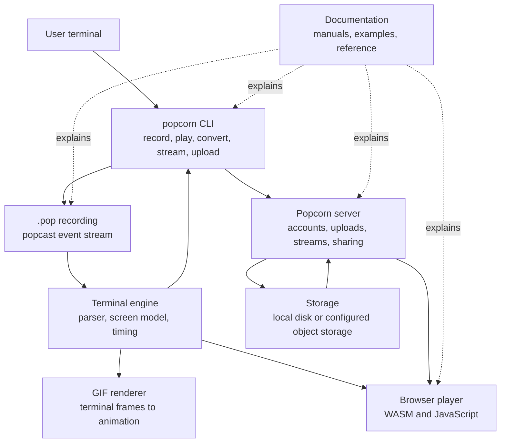
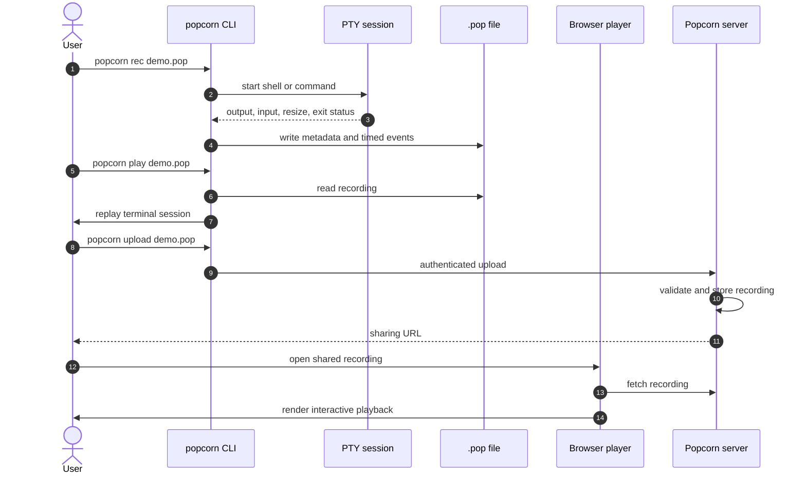
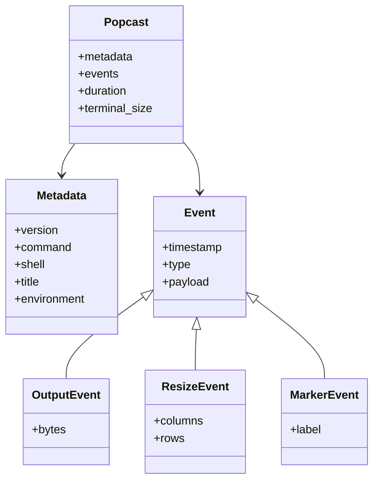
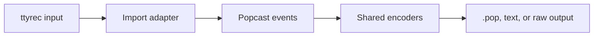
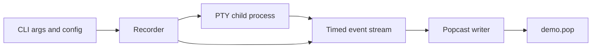
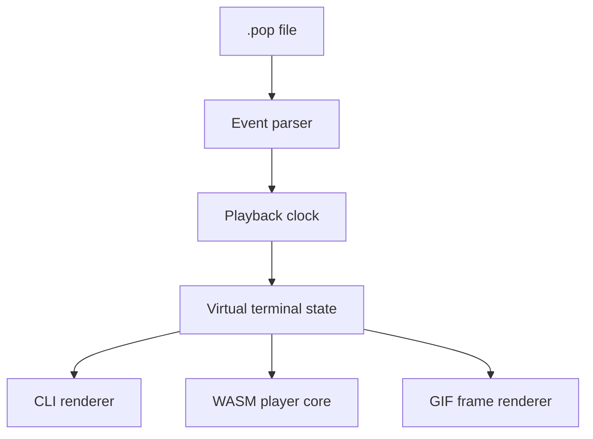
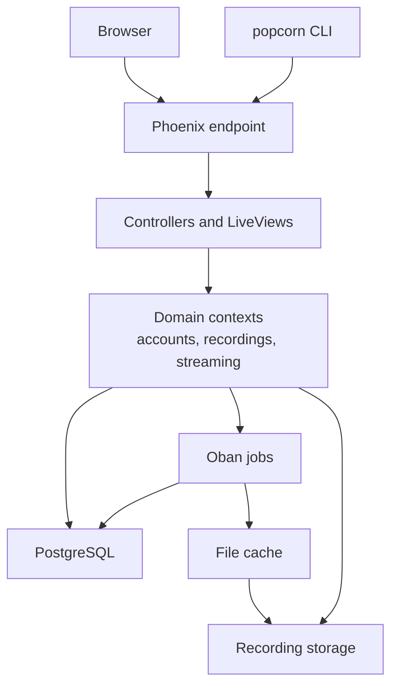
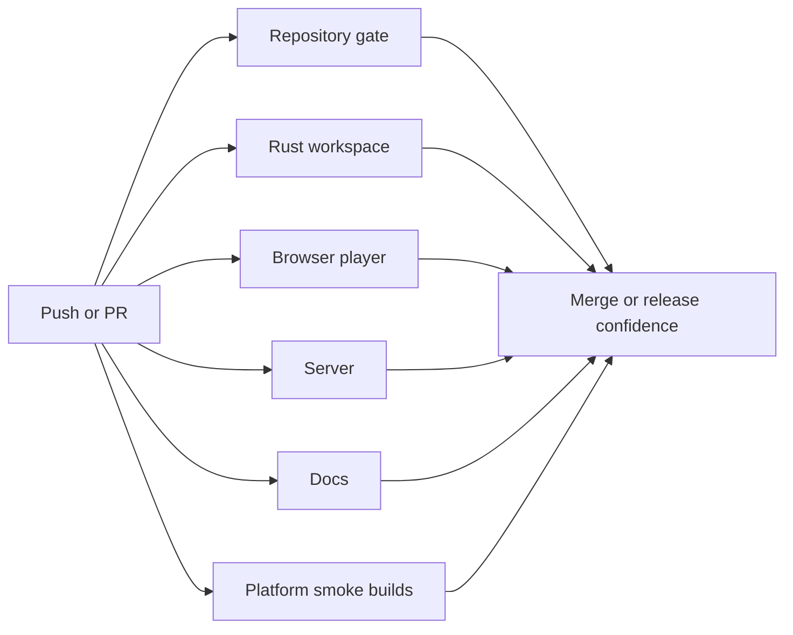

# Architecture

Popcorn is organized as a monorepo so the CLI, terminal model, browser player,
server, renderers, release workflows, and documentation evolve against one
recording format and one product vocabulary.

The core contract is the `.pop` recording file. The CLI creates it, the player
renders it, the server stores and shares it, the docs explain it, and release
automation ships tools that understand it.

## System Boundaries

## Package Responsibilities

| Path | Responsibility | Primary checks |
| --- | --- | --- |
| `crates/cli` | Command-line interface, PTY recording, playback, conversion, upload, streaming client behavior. | `cargo fmt`, `cargo clippy`, `cargo test`, CLI integration script. |
| `crates/avt` | Terminal event parsing, virtual terminal state, text extraction, parser tests and fuzz helpers. | Rust workspace checks, parser fixtures, fuzz helper where relevant. |
| `crates/agg` | GIF generation from terminal recordings. | Rust workspace checks and renderer-specific tests. |
| `packages/player` | Browser player package, WASM build, JavaScript API, theme and rendering behavior. | `bun run build`, Playwright or package tests. |
| `apps/server` | Phoenix application for accounts, uploads, hosted recordings, streaming, admin surfaces, file cache, and background jobs. | `mix compile`, `mix test`, asset install, PostgreSQL-backed tests. |
| `apps/docs` | Product documentation site, examples, product manuals, and published docs assets. | `mkdocs build --strict`. |
| `docs` | Contributor and operator documentation for this repository. | Markdown gate, repository gate. |
| `.github` | CI and release workflows. | `actionlint`, release smoke validation, GitHub Actions CI. |
| `.flox` | Reproducible local tool environment. | `flox activate`, repository gate. |

## Recording Lifecycle

The lifecycle has three important invariants:

- A valid `.pop` recording must be readable without network access.
- Playback should preserve terminal timing and screen state, but must not
  require the original command environment.
- Upload and sharing are optional layers over the local recording format.

## Recording Format Contract

New recordings use the `.pop` extension and the user-facing `popcast` format
name. The format carries session metadata and a timed terminal event stream.
Readers may support older historical payload shapes when useful for fixtures or
imports, but new documentation and examples should use `.pop`.

Compatibility code should stay at the edges. Internals should normalize into
the current domain model as early as possible, so rendering, text extraction,
server processing, and tests do not need to know every historical detail.

Import adapters follow that same rule. For example, the CLI ttyrec importer
reads ttyrec frames at the command boundary, normalizes them into popcast output
events, and then hands those events to the normal encoders.

## CLI Execution Path

The CLI records commands through a PTY-backed execution path on Unix platforms.
The recorder starts the requested command or shell, relays input and terminal
resize events, captures output with timing information, and writes the final
exit status.

Recording code should avoid hidden process-global state. Terminal dimensions,
environment values, output paths, API endpoints, and authentication should come
from explicit configuration, command arguments, or well-documented environment
variables.

## Playback And Rendering Path

Rendering uses a terminal model rather than treating output as plain text. This
keeps cursor movement, color, resizing, alternate screen behavior, and control
sequences consistent across CLI playback, GIF generation, and browser playback.

When changing terminal behavior, prefer shared parser or terminal fixtures over
component-local assumptions. A parser fix that only updates the browser player
but not CLI playback is usually incomplete.

## Server Architecture

The server is a Phoenix application. It owns hosted recording workflows,
streaming workflows, account state, admin surfaces, background jobs, and cached
derived assets such as rendered images.

The server should keep external side effects behind clear boundaries:

- Database reads and writes go through contexts.
- Background work goes through Oban workers.
- Cached derived files are disposable and rebuildable.
- Uploaded recordings are source data and require explicit retention and backup
  decisions.
- Server examples should use `popcorn.example.com` unless documenting a real
  local development URL.

## CI And Release Boundary

CI is part of the architecture because it defines what the repository promises
on every push. The main workflow checks the repository gate, Rust workspace,
browser player, Phoenix server, docs, release workflow shape, and platform
smoke builds.

Release automation should only publish artifacts that CI can build and smoke
test. Documentation should not claim support for package channels or deployment
targets that do not have automation in this repository.

## Design Rules

- Keep `.pop` as the primary external recording contract.
- Keep user-facing terminology consistent: Popcorn for the product and popcast
  for the recording format.
- Keep compatibility handling near parsers, importers, and migration code.
- Keep local development commands reproducible through Flox whenever practical.
- Keep CI gates close to the developer gate so local failures match remote
  failures.
- Keep server deployment examples self-hosted and placeholder-based unless the
  repository contains production automation for a different path.
