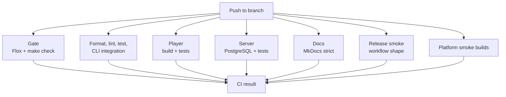
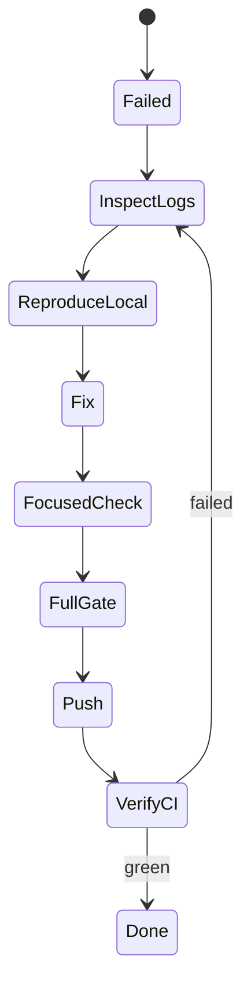
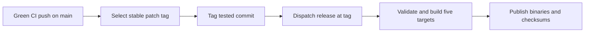
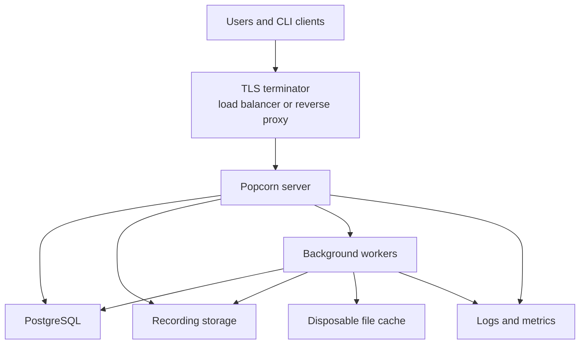
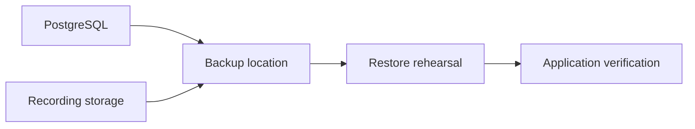

# Operations

This guide describes the operational expectations encoded in this repository:
CI, release automation, server deployment assumptions, observability, backups,
and incident response.

## CI Overview

CI runs on Blacksmith GitHub Actions runners. The main workflow checks the
repository gate, Rust workspace, browser player, Phoenix server, product docs,
release workflow shape, and platform smoke builds.



The main workflow covers:

- Rust format, clippy, unit tests, and CLI integration tests.
- Platform smoke builds for Linux GNU, Linux musl, Linux ARM64, macOS Intel,
  and macOS Apple Silicon.
- Browser player build and Playwright tests.
- Phoenix server compile and tests against PostgreSQL 16.
- MkDocs strict build.
- Release workflow smoke validation.
- Repository gate through Flox and `make check`.

Use published action versions and keep runner labels in the Blacksmith family.

## CI Failure Response

Treat CI failures as signal until proven otherwise. Avoid retrying a failed job
without reading the failing log unless there is clear evidence of external
infrastructure failure.



Recommended sequence:

1. Use `gh run view` or the GitHub UI to identify the failing job.
1. Pull logs for the specific job and search for the first actionable error.
1. Reproduce locally with the closest matching command.
1. Fix the underlying issue.
1. Run the focused check and `make check`.
1. Push and watch the new CI run through completion.

Useful commands:

```bash
gh run list --repo smeltery/popcorn --branch main --limit 5
gh run view <run-id> --repo smeltery/popcorn --json jobs
gh run watch <run-id> --repo smeltery/popcorn --interval 15 --exit-status
```

## Release Automation

The release workflow builds CLI binaries for:

- `x86_64-unknown-linux-gnu`
- `x86_64-unknown-linux-musl`
- `aarch64-unknown-linux-gnu`
- `x86_64-apple-darwin`
- `aarch64-apple-darwin`

Following [smeltery/hab's auto-release pattern](https://github.com/smeltery/hab/blob/main/.github/workflows/auto-release.yml),
`auto-release.yml` waits for a successful **CI** push run on `main`. It skips
failed, pull-request, and superseded runs. It tags the tested commit with the
next stable patch version and explicitly dispatches `release.yml` at that tag
with `draft=false`. Explicit dispatch is necessary because tags pushed with
`GITHUB_TOKEN` do not trigger another workflow.

Version selection ignores prerelease and malformed tags, compares versions
numerically, and starts at `v0.1.0` if there are no stable tags. Existing history
is retained (for example, `v3.2.0` advances to `v3.2.1`). Rerunning CI for the
current commit reuses its existing stable tag and redispatches the release,
allowing recovery after a failed build without allocating another version.
Automatic tag creation is serialized and only needs the built-in token with
`contents: write` and `actions: write`; repository rules must permit tag creation.

Manual `vMAJOR.MINOR.PATCH` and prerelease tag pushes remain supported. Tag
releases publish immediately. Manual workflow dispatch accepts `version` and
`draft` inputs and defaults to a draft. To retry a specific tag, run:

```bash
gh workflow run release.yml --ref v3.2.1 -f version=v3.2.1 -f draft=false
```

The workflow uploads `popcorn-<target>` binaries plus `SHA256SUMS`. Automatic
releases advance Git tags; they do not rewrite Cargo package versions.



Do not document package channels as official unless this repository contains
the publishing automation, checks, and credentials needed to maintain them.

## Package Channels

Treat source builds and GitHub release artifacts as canonical until package
channels are explicitly wired up. Do not document apt, pacman, Homebrew, npm, or
container publishing as official unless the publishing automation exists in this
repository.

Package channel additions should include:

- workflow automation,
- reproducible build inputs,
- smoke validation,
- rollback or yank instructions,
- ownership of credentials,
- user-facing installation docs,
- CI coverage that fails when packaging breaks.

## Server Deployment Model

Popcorn server is self-hosted by default. Public examples use
`https://popcorn.example.com` as a placeholder; replace it with the deployed
instance URL.



Minimum deployment requirements:

- TLS termination before traffic reaches users.
- A PostgreSQL database with backups and tested restore steps.
- Persistent recording storage with explicit retention policy.
- Runtime secrets provided through the deployment environment.
- Background job execution for asynchronous work.
- Logs sufficient to diagnose failed uploads, failed renders, and background
  job failures.

## Configuration And Secrets

Server deployments should keep runtime configuration outside source control.
Important values include:

- `DATABASE_URL`
- `POPCORN_API_URL`
- signing secrets
- object-store credentials
- email delivery credentials
- OAuth or identity-provider credentials, if configured
- admin bootstrap credentials, if configured

Secrets must not be committed to the repository, stored in docs examples, or
printed in CI logs. Use placeholder values in documentation.

## Storage And Retention

Classify stored files into two groups:

| Data | Examples | Operational handling |
| --- | --- | --- |
| Source data | Uploaded `.pop` files, stream recordings, account-owned media. | Back up, protect, retain or delete according to policy. |
| Derived data | PNG previews, rendered images, temporary work directories, file-cache output. | Rebuildable; safe to prune when source data remains. |

The server file cache is not a backup. Cache pruning must never remove source
recordings or the only copy of user data.

## Backups And Restore

Backups are only useful if restore is tested. For production-like deployments,
document:

- database backup frequency,
- storage backup frequency,
- restore target,
- restore command sequence,
- expected recovery point objective,
- expected recovery time objective,
- owner for scheduled restore tests.



## Observability

At minimum, deployments should be able to answer:

- Are users able to upload recordings?
- Are users able to view recordings?
- Are background jobs draining?
- Is PostgreSQL healthy?
- Is storage reachable?
- Are cache pruning jobs succeeding?
- Are error rates or response times changing?

Prefer structured logs for operational events such as upload failures, render
failures, authentication failures, and background job failures. Avoid logging
recording contents, secrets, or bearer tokens.

## Rollback Posture

Rollback depends on what changed:

| Change type | Rollback approach |
| --- | --- |
| CLI release artifact | Leave prior GitHub release artifacts available and publish a fixed release. |
| Docs-only change | Revert or amend the docs change and rebuild docs. |
| Server code change | Redeploy previous server revision if database migrations are compatible. |
| Database migration | Prefer forward fixes; destructive migrations need explicit backup and restore planning. |
| Player package change | Rebuild and publish a corrected package or server asset set. |

Migrations should be designed for deploy safety. Avoid coupling irreversible data
changes to code changes unless there is a documented rollback or forward-fix
plan.

## Operational Review Checklist

Before merging operationally meaningful changes, confirm:

- CI covers the changed path.
- Docs match the automation that exists in this repository.
- Secrets are passed through runtime configuration, not source files.
- New storage or database state has backup and retention implications.
- Release artifacts are smoke-tested before users are pointed at them.
- Server changes have a rollback or forward-fix story.
