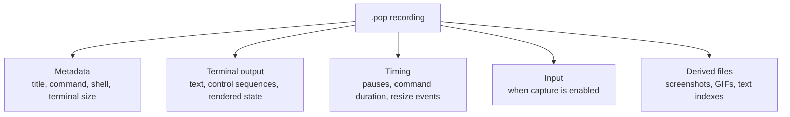
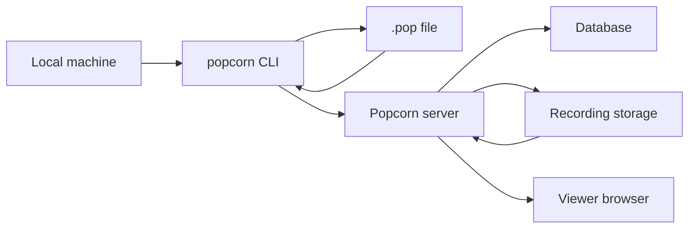
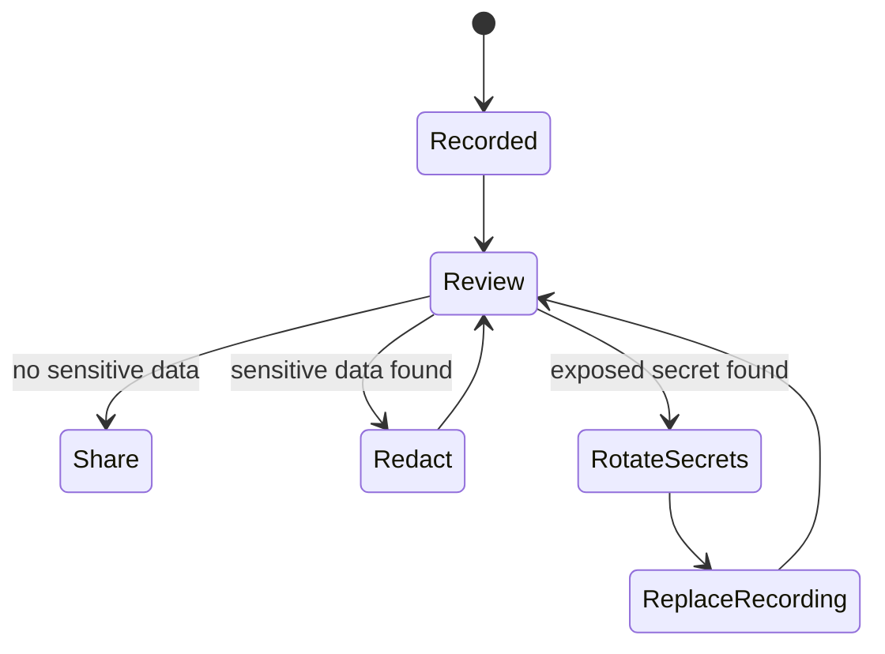
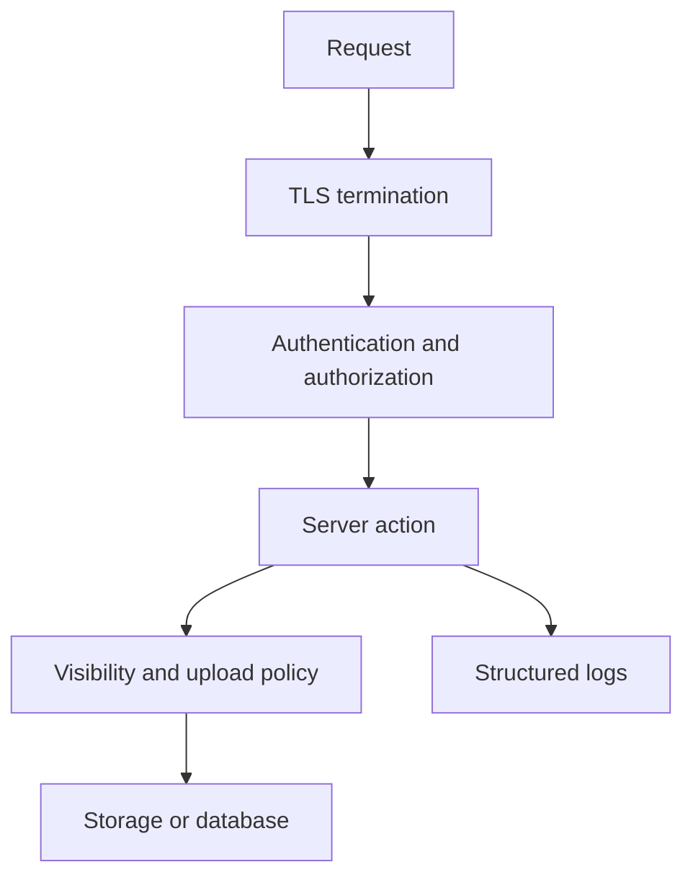
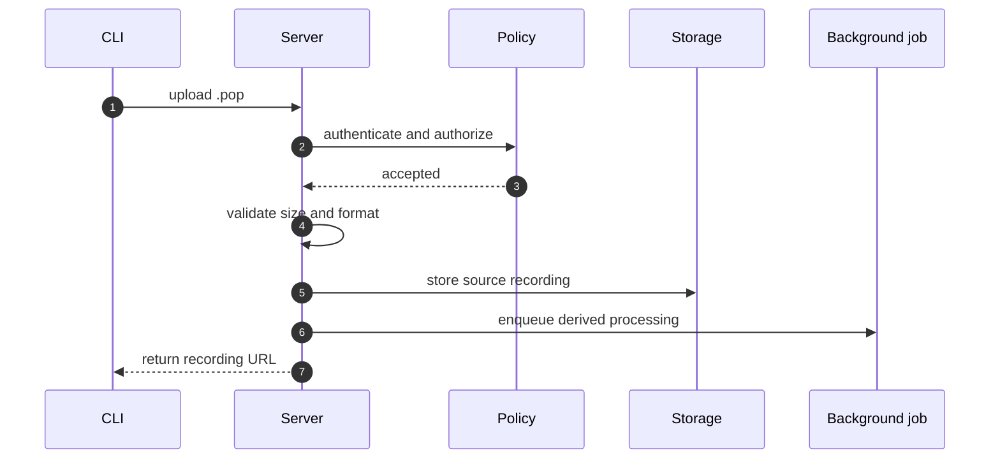
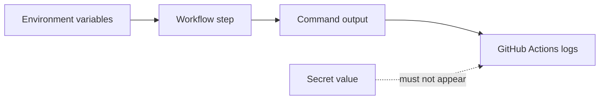

# Security

Popcorn records terminal activity. That makes security and privacy part of the
core product, not a secondary concern. A recording can reveal commands, output,
timing, hostnames, paths, prompts, and accidentally printed secrets.

## Data Classification

Treat recordings as potentially sensitive until reviewed. A terminal session can
contain:

- terminal output,
- commands and prompts,
- working directories and hostnames,
- repository names and branch names,
- window resize timing,
- markers and metadata,
- keyboard input when input capture is enabled,
- environment names,
- account identifiers,
- secrets accidentally printed by programs.

If a secret appears in a recording, treat it as exposed and rotate it. Editing
or deleting the recording is not enough once the file may have been shared.

## Trust Boundaries

The main trust boundaries are:

- Local recording: users control what they record and where files are written.
- Upload: a local file crosses into a server deployment.
- Storage: source recordings persist beyond the original terminal session.
- Sharing: a viewer may access recording contents through a URL or account
  permission.
- Derived assets: generated previews, GIFs, search text, and cached files may
  reveal the same sensitive content as the source recording.

## Recording Review

Before sharing a recording, review it for:

- secrets in command output,
- pasted tokens or passwords,
- private repository URLs,
- internal hostnames,
- customer data,
- personal data,
- shell history snippets,
- hidden prompts or alternate-screen content,
- long pauses that reveal workflow timing when that matters.

Do not assume terminal clearing removes sensitive data from the event stream.
If the bytes were recorded, a parser, export path, or derived artifact may still
expose them.

## Sharing Model

Prefer local files or a self-hosted Popcorn server for internal material. Use
unguessable links and private visibility where the server supports them, but do
not treat link secrecy as a substitute for access control.

Sharing controls should be understood as layers:

| Layer | Protects against | Does not protect against |
| --- | --- | --- |
| Local file permissions | Other local users without file access. | Anyone who receives a copy. |
| Private server visibility | Anonymous browsing. | Authorized users, admins, logs, backups. |
| Unguessable link | Casual discovery. | Forwarding, screenshots, referrer leaks, compromised link. |
| Account-based access | Unauthorized viewers. | Incorrect permission grants or admin access. |

## Server Security

Server deployments should:

- terminate TLS,
- restrict upload policy,
- set retention rules,
- use explicit storage and backups,
- protect admin surfaces,
- separate runtime secrets from source code,
- avoid logging recording contents,
- rotate credentials when exposure is suspected.

Important runtime values include `POPCORN_API_URL`, database credentials,
object-store credentials, signing secrets, email credentials, and any identity
provider credentials. Keep them out of source control.

## Upload Handling

Uploads should be validated before they become durable source data. Validation
should check format shape, size limits, account permissions, and visibility
rules. Derived work should happen asynchronously when possible so expensive
processing does not block request handling.

Failure handling must avoid partial public state. If source storage succeeds but
metadata persistence fails, the deployment needs cleanup or reconciliation. If
metadata persists but derived processing fails, the recording should still have
a clear user-visible state.

## Derived Artifacts

Derived artifacts can include:

- PNG previews,
- GIF exports,
- text extraction,
- rendered frame caches,
- temporary work directories,
- search indexes.

Derived artifacts must inherit the sensitivity of the source recording. Cache
files should be disposable, but they are not harmless while they exist.

Security expectations:

- Keep derived files scoped to the recording or account that produced them.
- Prune temporary work directories.
- Do not serve derived files across visibility boundaries.
- Do not log extracted text from private recordings.
- Rebuild derived artifacts from source data rather than treating them as
  authoritative.

## Dependency Security

Popcorn components retain their upstream licenses; see the root LICENSE. Third-party crates,
npm packages, Hex dependencies, Python packages, fonts, and runtime images keep
their own licenses and security update cadence.

Dependency changes should be reviewed for:

- new native build steps,
- new postinstall scripts,
- new network access during build,
- license compatibility,
- maintenance status,
- transitive dependency expansion,
- CI reproducibility.

## CI And Secret Hygiene

CI must not expose secrets in logs. Workflow changes should avoid printing full
environment dumps, tokens, signed URLs, private keys, or deployment credentials.

Repository checks should run with the least credentials needed. Release and
deployment workflows may require stronger permissions, but those permissions
should be scoped to the workflow and documented in review.

## Security Review Checklist

Use this checklist for changes that touch recording, upload, sharing, auth,
server storage, generated assets, CI secrets, or release automation:

- Does this change create, copy, transform, upload, or publish recording data?
- Could terminal output, input, metadata, or derived assets reveal secrets?
- Are size limits and parser failure paths explicit?
- Does the server enforce visibility before serving source or derived files?
- Are upload and sharing permissions tested?
- Are runtime secrets excluded from source, docs examples, and logs?
- Can failed background work leave public partial state?
- Are cache and temporary files pruned without deleting source data?
- Do docs accurately describe the privacy boundary?

## Incident Response

If sensitive data is published:

1. Remove or restrict the recording and any derived artifacts.
1. Rotate exposed secrets.
1. Invalidate shared links or sessions when applicable.
1. Review logs and backups for additional exposure.
1. Document what was exposed, when it was exposed, and who had access.
1. Add tests, checks, or docs to reduce the chance of recurrence.

Deleting a recording does not rotate a secret. Rotate first when credential
exposure is plausible.
