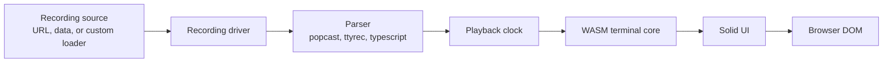
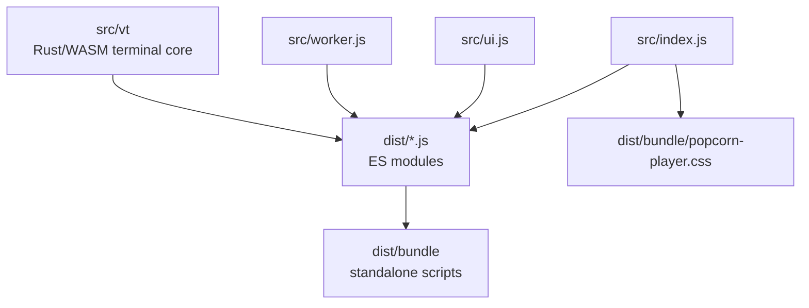

# popcorn player

[](https://github.com/dotbrains/popcorn/actions/workflows/ci.yml)
[](https://github.com/dotbrains/popcorn/actions/workflows/release.yml)
[](https://github.com/dotbrains/popcorn/releases/latest)
[](package.json)
[](package.json)
[](LICENSE)

`popcorn-player` is the browser player for Popcorn terminal session recordings.
It renders lightweight `.pop` files as interactive terminal playback instead of
heavy video files.

Use it in documentation, blogs, internal runbooks, training material, product
demos, and any web page that needs terminal playback with copyable text,
markers, keyboard controls, themes, and programmatic control.

## What This Package Owns

This package owns browser playback:

- loading static recordings from URLs, inline data, or custom loaders,
- parsing popcast and other supported terminal recording formats,
- terminal emulation through the bundled WASM terminal core,
- playback timing, seeking, looping, markers, and idle-time limiting,
- Solid-based player UI and overlays,
- standalone browser bundles and ESM package output,
- CSS themes and terminal styling,
- Playwright browser tests.

It does not own recording, upload, server persistence, or GIF rendering. Those
live in other Popcorn components.

## Quick Start

Install from npm:

```sh
npm install popcorn-player
```

Import the package in an application bundle:

```javascript
import * as PopcornPlayer from 'popcorn-player';
import 'popcorn-player/dist/bundle/popcorn-player.css';

PopcornPlayer.create('/demo.pop', document.getElementById('demo'));
```

Use the standalone bundle on a plain HTML page:

```html
<link rel="stylesheet" href="/popcorn-player.css">
<div id="demo"></div>
<script src="/popcorn-player.min.js"></script>
<script>
  PopcornPlayer.create('/demo.pop', document.getElementById('demo'));
</script>
```

## Playback Flow



The player works from structured terminal events, not pixels. That keeps
terminal text selectable and lets the UI expose markers, keystrokes, playback
speed, pause, seek, and fullscreen controls.

## Package Shapes

`bun run build` produces two player shapes.

The combined build is the default and covers most uses:

| File | Use |
| --- | --- |
| `dist/index.js` | ESM entry point for bundlers. |
| `dist/bundle/popcorn-player.js` | Standalone browser IIFE. |
| `dist/bundle/popcorn-player.min.js` | Minified standalone browser IIFE. |
| `dist/bundle/popcorn-player.css` | Player stylesheet. |

The split build separates UI from parsing and terminal processing:

| File | Use |
| --- | --- |
| `dist/ui.js` | ESM UI entry point. |
| `dist/bundle/popcorn-player-ui.js` | Standalone UI bundle. |
| `dist/bundle/popcorn-player-ui.min.js` | Minified standalone UI bundle. |
| `dist/bundle/popcorn-player-worker.js` | Standalone worker bundle. |
| `dist/bundle/popcorn-player-worker.min.js` | Minified standalone worker bundle. |

Use the split build only when very large or high-rate recordings make worker
isolation worth the extra setup.



## Source Map

| Path | Responsibility |
| --- | --- |
| `src/index.js` | Combined player entry point. |
| `src/ui.js` | UI-only entry point for split deployments. |
| `src/worker.js` | Worker entry point for split deployments. |
| `src/core.js` | Player orchestration and event APIs. |
| `src/driver/` | Recording and stream drivers. |
| `src/parser/` | Built-in recording parsers. |
| `src/components/` | Solid UI components and overlays. |
| `src/vt.js` | JavaScript bridge to the terminal core. |
| `src/vt/` | Rust/WASM terminal core package. |
| `src/less/` | Player CSS, themes, and layout styling. |
| `tests/` | Playwright browser tests and fixtures. |
| `index.d.ts` | TypeScript declarations for the public API. |
| `rollup.config.mjs` | ESM and standalone bundle build configuration. |

## Supported Sources

Load from a URL:

```javascript
PopcornPlayer.create('/demo.pop', container);
```

Load from multiple fallback URLs:

```javascript
PopcornPlayer.create({ url: ['/demo.pop', '/fallback.pop'] }, container);
```

Load inline data:

```javascript
PopcornPlayer.create({ data: recordingText }, container);
```

Choose a parser explicitly:

```javascript
PopcornPlayer.create(
  { url: '/session.ttyrec', parser: 'ttyrec' },
  container,
);
```

## Player API

Create a player:

```javascript
const player = PopcornPlayer.create('/demo.pop', container, {
  autoPlay: true,
  speed: 1.25,
  theme: 'monokai',
  markers: [[12.5, 'deploy']],
  pauseOnMarkers: true,
});
```

Control playback:

```javascript
await player.play();
await player.pause();
await player.seek('50%');
await player.seek({ marker: 'next' });
```

Listen for events:

```javascript
player.addEventListener('play', () => {
  console.log('playing');
});

player.addEventListener('marker', (event) => {
  console.log(event.label, event.time);
});
```

Dispose when removing the player from the page:

```javascript
player.dispose();
```

## Build From Source

The recommended local environment is Flox from the repository root:

```sh
flox activate
cd packages/player
bun install --frozen-lockfile
bun run build
```

Without Flox, install Bun, Node.js 24 or newer, Rust, and the
`wasm32-unknown-unknown` target:

```sh
rustup target add wasm32-unknown-unknown
cd packages/player
bun install --frozen-lockfile
bun run build
```

## Test

Run the browser test suite:

```sh
cd packages/player
bun run test
```

Run build and tests together:

```sh
cd packages/player
bun install --frozen-lockfile
bun run build
bun run test
```

CI installs Chromium and Firefox through Playwright before running tests.

## Contributor Notes

- Keep public API changes reflected in `index.d.ts` and product docs.
- Parser changes should include fixtures or focused parser tests.
- UI changes should preserve keyboard controls, copyable terminal text, and
  mobile/desktop layout behavior.
- Terminal behavior changes may belong in `crates/avt` instead of the browser
  bridge. Check whether the issue is parser state, playback timing, or UI
  rendering before changing the player.
- Keep generated `dist/` output out of ordinary source changes unless release
  automation explicitly requires it.

## Documentation

Full user documentation lives in the Popcorn docs:

- [player overview](../../apps/docs/docs/manual/player/index.md)
- [quick start](../../apps/docs/docs/manual/player/quick-start.md)
- [loading recordings](../../apps/docs/docs/manual/player/loading.md)
- [options](../../apps/docs/docs/manual/player/options.md)
- [API](../../apps/docs/docs/manual/player/api.md)
- [parsers](../../apps/docs/docs/manual/player/parsers.md)

## License

`popcorn-player` is licensed under the PolyForm Shield License 1.0.0. See
[LICENSE](./LICENSE) for details.
